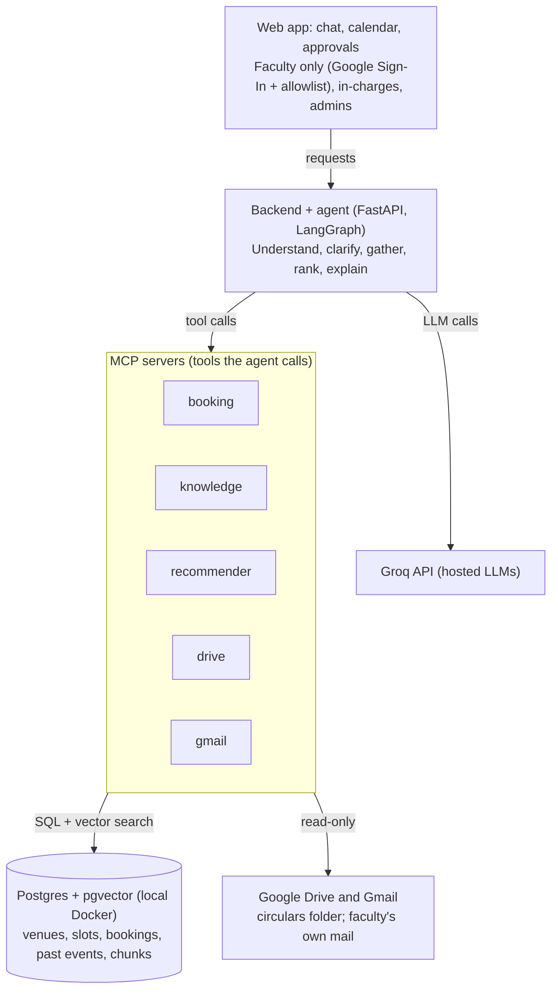

# Lab & Venue Booking Agent: Plan and Architecture

Last updated: 22 Oct 2026 · Owner: Walter
Live version (editable): https://claude.ai/code/artifact/c5f35132-3cb2-477e-ab23-5598213f2c50

## Summary

A faculty member signs in, describes the event to a chatbot (or lets it read the relevant mails from their Gmail), answers a few follow-up questions, and gets 2-3 free venues ranked with reasons, including warnings like "this hall is usually taken for admissions in March". The database decides availability; the agent understands requests, gathers context and explains.

Key choices:

- **Structured data is not RAG.** Timetables (from PDFs) and bookings are normalised into Postgres and queried exactly. RAG covers circulars and past-event reports in a Drive folder, and faculty mails when they link Gmail.
- **Hard and soft conflicts.** A hard conflict is a real booking or class. A soft conflict is a pattern from history (a venue used for the same purpose at the same time of year in past years). Soft conflicts never block a booking; they lower the venue's rank and are always told to the user.
- **Faculty only.** Only accounts on a faculty allowlist can sign in and book; this is enforced in the backend, not by the agent.
- **Venue in-charges approve.** Every booking, and every change of venue, date or time, needs the in-charge's approval. Every change notifies everyone involved.
- **MCP as the tool layer.** Bookings, knowledge search, recommendations, Drive and Gmail are small MCP servers the agent calls.
- **Groq for the LLM, everything else local.** No GPU needed: chat and extraction go to Groq's hosted models; Postgres, embeddings, sync and the app run on your machine with your personal Google account. GCP stays for a later pilot.

## Problem, goals and scope

Today a booking means finding the right timetable in Drive, digging through Gmail for who already asked for the hall, and calling the in-charge. There is no single place that says whether a venue is free.

| User | What they need |
| --- | --- |
| Faculty member (the only role that can book) | Ask in plain language, get 2-3 suitable free venues with reasons, book in one step |
| Venue / lab in-charge | See pending requests, approve or reject, avoid double bookings |
| Admin / HOD | Calendar of all venues, usage reports, policy rules in one place |

**Goals for v1**

1. One source of truth for venue availability, combining recurring timetable slots and ad-hoc bookings.
2. A chat agent that turns "seminar with an IIT professor, ~60 students, needs a projector, next Thursday afternoon" into a ranked shortlist.
3. An approval flow with email and calendar notifications, including modify and cancel.
4. Automatic ingestion of timetable PDFs, circulars and past-event reports from Drive, and on-demand reading of a faculty's own Gmail.

**Out of scope for v1:** payments, catering/logistics, student-facing mobile app, multi-campus.

## Architecture overview

Four layers: a web app, a backend that hosts the agent, a set of MCP servers that are the agent's only hands, and the data stores behind them.

The agent sends language work to Groq and does everything else through MCP servers; scheduled jobs use the drive server to keep Postgres and the vector index current, while the gmail server only ever reads the signed-in faculty's own mail.

## Data sources and ingestion

Ingestion turns scattered files and mails into two things: rows in Postgres (exact, queryable) and chunks in the vector index (searchable context). Every extracted row keeps a link back to its source file or mail so a person can verify it.

| Source | Typical content | Goes to | How it is parsed |
| --- | --- | --- | --- |
| Timetable PDFs | Weekly class slots per room | `recurring_slot` table | pdfplumber (or Camelot) pulls the grid; the LLM maps cells to {room, weekday, start, end, course, class}; a person checks the result in the review queue before it counts |
| Drive folder: circulars | Event announcements: title, date, time, venue, audience, guests | Vector index + `past_event` rows | Chunked and embedded; the LLM also extracts the structured fields |
| Drive folder: past-event reports | Venue, dates, times, participant count, topics, outcomes | Vector index + `past_event` rows | Same as circulars; these are the main input for recommendations and seasonal patterns |
| Faculty Gmail (only when that faculty links it) | Invitations, speaker confirmations, internal requests about the event they are booking | The current booking draft only | Searched on demand during the chat; extracted fields are shown to the faculty to confirm; mails are not stored or shared |
| Venue master list | Capacity, equipment, lab computers, in-charge | `venue` table | Entered once by hand (a Sheet or CSV import) |

**Access.** Create a free Google Cloud project (no billing needed) only to get an OAuth client, enable the Drive, Gmail and Calendar APIs, and keep the consent screen in "Testing" mode. Two kinds of access:

- **The system's Drive folder:** your personal account, `drive.readonly`, one folder of circulars, reports and timetable PDFs.
- **Each faculty's Gmail:** asked for separately when a faculty clicks "Link Gmail" (`gmail.readonly`, incremental authorization). In Testing mode every faculty must be added as a test user (up to 100), which suits a prototype. Tokens in Testing mode expire after about 7 days, so the app should ask to re-link gracefully.

**Sync.** A local job (APScheduler inside the backend, every 15-30 min, plus a "sync now" button) uses the Drive Changes API to fetch only new or edited files from the folder; Gmail is read live, only during a faculty's chat.

**Review queue.** Anything the model extracts with low confidence, or that conflicts with an existing booking, lands in an admin screen to accept, edit or reject. This is the main defence against a model misreading a timetable.

## Data model

Twelve tables in Postgres carry the system. Availability is a query over `recurring_slot` and `booking`; seasonal warnings come from `usage_pattern`; the LLM never guesses either.

| Table | Key columns | Notes |
| --- | --- | --- |
| `faculty` | email, name, department, role (faculty / in-charge / admin), gmail_linked | The allowlist: only these accounts can sign in and book |
| `venue` | id, name, building, type (hall/lab/classroom/seminar room), capacity, equipment[] (projector, PA, AC, n_computers, software), in_charge | Hand-entered once; the most important table to get right |
| `recurring_slot` | venue_id, weekday, start, end, valid_from, valid_to, course, class, source_ref | From timetable PDFs; one row per weekly class |
| `booking` | id, venue_id, start_ts, end_ts, status (hold / pending / confirmed / rejected / expired / cancelled), event_id, requested_by, approved_by, soft_conflict_note, replaces_booking_id, calendar_event_id, version | Exclusion constraint on (venue_id, time range) for active rows makes double booking impossible; a change request is a new row pointing at the one it replaces |
| `booking_party` | booking_id, email, role (organiser / co-organiser / contact / in-charge / admin) | Everyone who is notified about this booking |
| `booking_history` | booking_id, actor, action (requested / approved / rejected / edited / change-requested / cancelled / expired), before, after, reason, at | Audit trail; drives the "what changed" text in notices |
| `notification` | id, booking_id, recipient, channel (email / calendar / in-app), payload, status (queued / sent / failed), attempts | Outbox, written in the same transaction as the change |
| `event` | id, title, category, format (talk / hands-on / mixed), expected_headcount, significance (1-3), guest_profile, requirements[], description | One per booking request |
| `past_event` | same fields as `event` + venue_id, date, start, end, actual headcount, topics, source_ref | Extracted from circulars and reports, plus every confirmed booking |
| `usage_pattern` | venue_id, category (e.g. admissions), window (week-of-year range), years_seen, years_observed, confidence, evidence_refs | Derived nightly from `past_event`; drives soft-conflict warnings |
| `expected_reservation` | venue_id, category, date range, owner team, note | Optional: an admin can declare "admissions will need this hall in March"; warns, never blocks |
| `document_chunk` | text, embedding (pgvector), source_type, source_ref, venue_id?, date? | The RAG index, with metadata for filtering |

An exclusion constraint (`EXCLUDE USING gist (venue_id WITH =, tstzrange(start_ts, end_ts) WITH &&) WHERE (status IN ('hold', 'pending', 'confirmed'))`, which needs the `btree_gist` extension) is the single guarantee against clashes. Recurring slots are expanded into the same check at query time.

**Local database.** Run Postgres 16 with pgvector in Docker (the `pgvector/pgvector:pg16` image, one `docker compose up`). It keeps the exclusion constraint and vector search in one local database and moves to a hosted Postgres later without code changes. SQLite with `sqlite-vec` is a lighter alternative, but it has no exclusion constraint, so the conflict check would have to run inside the booking transaction in code.

## RAG design

RAG answers "what do we know about this?" questions; it never answers "is this free?". The agent uses it to find rules, circulars and similar past events.

**What gets indexed:** the linked Drive folder of circulars and past-event reports, venue rules, and venue descriptions ("A Block Seminar Hall: 150 seats, used for guest lectures and admissions"). A faculty's mails are searched live through the Gmail API when they ask, never added to the shared index.

**Pipeline**

1. Parse: pdfplumber or Docling for PDF/DOCX, the Docs/Sheets export for Google files.
2. Chunk: 300-500 tokens with 50 overlap; a short circular stays one chunk.
3. Embed locally on CPU with a small model (`fastembed` or `sentence-transformers` with `bge-small-en-v1.5`); small embedding models are fast without a GPU, unlike chat models. Groq has no embeddings endpoint as far as I know.
4. Store in pgvector with metadata: source_type, venue_id, date, category, department.
5. Retrieve with hybrid search: vector similarity plus Postgres full-text (room names like "A Block Seminar Hall" match far better by keyword), filtered by metadata, top 5-8 chunks.
6. Alongside the chunks, the same documents are run once through LLM extraction into `past_event` rows, so questions like "how often was this hall used in March?" are answered by SQL, not by reading chunks.

**Why agentic.** Instead of always stuffing retrieved text into the prompt, the agent decides which tool to call: `search_knowledge` for a policy question, `check_availability` for a time, `find_similar_events` for a recommendation. Retrieved chunks are short, cited and limited, which keeps prompts small and within Groq's free-tier token limits.

## MCP servers and tools

Five small MCP servers, written in Python with the official MCP SDK (FastMCP), expose everything the agent can do. Keep each tool narrow with strict JSON schemas: models pick the right tool far more reliably from 10-15 well-named tools than from 40.

| Server | Tools | Side effects |
| --- | --- | --- |
| `booking-mcp` | `list_venues(filters)`, `check_availability(venue_ids, start, end)`, `find_free_venues(start, end, min_capacity, format, equipment)`, `create_hold(venue_id, start, end, event)`, `list_my_bookings()`, `edit_booking(id, fields)`, `request_change(id, new_venue, new_start, new_end)`, `cancel_booking(id, reason)` | Acts only on the signed-in faculty's own bookings; approvals are a human action in the UI; the agent must get an explicit yes before change and cancel calls |
| `knowledge-mcp` | `search_knowledge(query, filters)`, `get_venue_rules(venue_id)` | Read-only |
| `recommender-mcp` | `find_similar_events(event)`, `get_usage_patterns(venue_ids, start, end)`, `rank_venues(event, candidate_venue_ids)` | Read-only |
| `drive-mcp` | `list_changed_files(folder)`, `read_file(id)` | Read-only, used by ingestion and for "show me the source" |
| `gmail-mcp` | `search_my_mail(query, newer_than)`, `read_message(id)` | Read-only, runs with the signed-in faculty's own token, so it can only ever see their mail |

Calendar and email notifications are sent by the backend's notification worker, not by the agent, so a model mistake can never notify people.

**Why MCP here:** you can test each server from Claude Desktop or the MCP Inspector before the agent exists, swap Groq for another model provider without touching tools, and reuse `booking-mcp` later for a WhatsApp or Google Chat bot.

## Agent design and booking workflow

Use a graph-shaped agent (LangGraph) rather than a free-running loop: each node has one job and a strict output schema, which keeps it predictable and easy to debug.

1. **Sign in.** Google Sign-In; the backend admits only emails in the `faculty` table. Everyone else sees an "ask the admin to add you" page.
2. **Describe.** The faculty types what they need. Optionally they press "Use my Gmail": the agent builds a search from what they said (e.g. `workshop speaker newer_than:60d`), shows the 3-5 best matching mails, and extracts details from the ones the faculty picks.
3. **Understand.** The LLM turns everything so far into a `BookingRequest` JSON (title, category, format, headcount, date window, start/end time, duration, equipment, guest profile, significance), using structured output so it always parses.
4. **Clarify.** Code lists the missing required fields; the agent asks for them in one or two natural questions (how many people, which dates, what times, hands-on or talk, any special guests) and loops back to Understand.
5. **Look up.** Tools run without the LLM choosing: `find_free_venues` (hard conflicts with classes and bookings removed), `get_usage_patterns` for the free ones, `find_similar_events`, `get_venue_rules`.
6. **Recommend.** `rank_venues` scores them. The LLM writes 2-3 options, each with reasons and sources, and states any soft conflict plainly, for example: "A Block Seminar Hall is free on 12 March, but it was used for admissions in March in 2024, 2025 and 2026 (admissions circulars). I'd suggest B Block Seminar Hall instead, which seats 120 and hosted three similar talks." If nothing fits, it offers the nearest free dates.
7. **Hold and approve.** The faculty picks a venue; `create_hold` reserves it for 48 h; the venue in-charge approves or rejects, and sees any soft-conflict note. On approval the booking is confirmed and notifications go out.

The free-form mode is still useful for questions ("Which labs have MATLAB?", "Who approves the auditorium?"): there the agent picks between `search_knowledge`, `list_venues` and `get_venue_rules` on its own, with a 4-step cap.

**Guardrails:** the agent can never confirm a booking, act for another faculty, or send mail; the faculty check and tool argument validation (Pydantic) happen in the backend; every statement about availability or past usage must come from a tool result in the same turn.

## Booking lifecycle: approve, modify, cancel, notify

Every booking needs a venue in-charge's approval, every change that touches the venue or time goes through the same approval, and every state change notifies everyone involved. Soft conflicts never block; they are carried as a warning on the booking at every step.

| Action | Who can do it | What happens | Who is notified |
| --- | --- | --- | --- |
| Request | Faculty | A 48 h hold is placed and the request goes to the venue's in-charge, with any soft-conflict warning attached | In-charge (new request); faculty (receipt) |
| Approve / reject | Venue in-charge | Approve confirms the booking (exclusion constraint checked); reject frees the slot, with a reason | Faculty, co-organisers |
| Hold expires | System | The slot is released if the in-charge has not acted in 48 h; the in-charge gets a reminder at 24 h | Faculty, in-charge |
| Minor edit (title, description, headcount within capacity, contacts) | Faculty | Applied at once, no re-approval | In-charge, co-organisers |
| Change venue, date or time, or headcount above capacity | Faculty (directly or by asking the agent) | A change request: the new slot is held, the original booking stays confirmed until the in-charge approves; on approval the swap happens in one transaction, on rejection the original stands. Availability and soft conflicts are re-checked for the new slot | In-charge(s) of old and new venue; faculty; co-organisers |
| Cancel | Faculty (own booking) or in-charge / admin with a reason | The slot is released at once | Faculty, co-organisers, in-charge, and anyone whose request was waiting on that slot |
| Clash created by a new timetable | System | The ingestion job flags confirmed bookings that now overlap a class, without cancelling them | Faculty and in-charge, to resolve |

**Parties involved** are stored on the booking: the requesting faculty, optional co-organisers and contacts, the in-charge of each venue touched, and admins who opt in.

**How notifications are sent**

- **Outbox pattern:** every state change writes a `booking_history` row and one `notification` row per recipient in the same database transaction; a background worker sends them with retries, so a change is never saved without its notices or the other way round.
- **Email** through the Gmail API from the system's Google account, with a summary of what changed (old vs new venue and time) and links to view, approve or cancel.
- **Calendar:** a Google Calendar event per booking on a system calendar, with the parties as attendees. Moving or cancelling the event with `sendUpdates=all` makes Google send updated invites itself.
- **In-app:** a notification bell and an approvals inbox for in-charges.

**Through the chat:** a faculty can say "move my AI seminar to Friday afternoon" or "cancel the hackathon booking". The agent finds their booking, re-runs availability and recommendations for a move, and always shows a summary and asks for an explicit yes before submitting a change request or cancellation.

## Venue recommendation from past events

The past-events data is what makes the system smarter than a capacity filter: it learns that a 40-person talk by a chief guest goes to the auditorium while a 40-person workshop goes to a lab.

**Fields extracted from circulars and reports** into `past_event` (aim for 200+ events, mock ones for the prototype):

| Field | Example | Why |
| --- | --- | --- |
| title, description, topics | "Guest lecture on GenAI by Dr. X, IIT Madras" | Text similarity |
| category | guest lecture / workshop / hackathon / training / exam / admissions / cultural / meeting | Strong predictor, and the key for seasonal patterns |
| format | talk / hands-on / mixed | Hands-on needs a lab with enough computers |
| headcount (expected, actual) | 60, 85 | Capacity fit and over-turnout |
| significance | 1 routine, 2 department-level, 3 institution-level / VIP | Captures the "small but important" case |
| guest_profile | none / internal / external academic / industry / government | Drives prestige venues |
| organiser_dept, audience | CSE, final year | Venue locality |
| venue, date, start, end | A Block Seminar Hall, 2025-03-10, 10:00-16:00 | The label to learn, and the input for seasonal patterns |

**Four stages**

1. **Hard filter (code):** capacity ≥ headcount × 1.1; format fits (hands-on → a lab with computers ≥ headcount; talk → hall, seminar room or classroom with a projector); requirements met; no class or booking in the slot; rules allow it.
2. **Soft-conflict check (code):** look up `usage_pattern` and `expected_reservation` for each remaining venue and the requested dates.
3. **Rank:**
    - v1 kNN: embed the event and its fields, find the 10 most similar past events, score each venue by how often similar events used it, weighted by similarity.
    - v2 learned ranker (LightGBM) once there are a few hundred real events.
    - Penalties: wasted capacity unless significance is high, and soft-conflict confidence (a hall used for admissions in 3 of the last 3 Marches drops well below the alternatives).
4. **Explain (LLM):** one or two sentences per venue, citing the similar events and stating every soft conflict.

**Seasonal usage (soft conflicts).** A nightly job groups `past_event` rows by venue, category and time of year (week-of-year with a ±2 week window) across past years:

- If the same category used the venue in that window in at least 2 of the last 3 years, it becomes a `usage_pattern` row with confidence = years seen / years observed (e.g. admissions, A Block Seminar Hall, weeks 9-13, 3 of 3, confidence 1.0) and links to the circulars that show it.
- An admin can also add an `expected_reservation` directly ("Admissions, A Block Seminar Hall, 1-31 March"), which counts as confidence 1.0.
- A venue with a soft conflict is still offered if the faculty insists, but it ranks lower, the agent always explains why with the evidence, and the in-charge sees the note when approving. Soft conflicts only ever warn.
- Recurring patterns from the timetable itself (e.g. a lab used every exam week) are found the same way.

**Feedback loop:** every confirmed booking becomes a new `past_event` row, and an in-charge overriding the top pick is logged as a training signal.

## Models and compute

Chat and extraction run on Groq's hosted models, so no GPU is needed; embeddings and ranking run locally on CPU. Groq's API is OpenAI-compatible and supports tool calling and JSON output.

| Job | Model | Where |
| --- | --- | --- |
| Agent: understanding, follow-up questions, tool calls, explanations | A large model with tool calling on Groq (for example Llama 3.3 70B, or a Qwen 3 or gpt-oss model) | Groq API |
| Bulk extraction: timetable cells, circulars, reports, mail triage | A small fast model on Groq (for example Llama 3.1 8B Instant), escalating to the large one when validation fails | Groq API |
| Embeddings | `bge-small-en-v1.5` via fastembed or sentence-transformers | Local CPU |
| Venue ranking and seasonal patterns | kNN + SQL, later LightGBM | Local CPU |

Model names on Groq change often; pick from the current list in the Groq console.

**Working within Groq's free tier:** it has per-minute and per-day request and token limits, which a prototype fits if ingestion runs in batches with retry and backoff and extraction results are cached by file hash so nothing is re-processed. Keep the model behind one small client wrapper (`langchain-groq` or the OpenAI SDK pointed at Groq) so you can switch models, or fall back to Ollama offline, by changing config.

**Privacy:** text sent to Groq leaves your machine. Send only the mails a faculty selects, never whole inboxes, and say so on the "Link Gmail" screen. Mock data has no such concern.

**Later, for a pilot:** move the app to Cloud Run and Postgres to Cloud SQL with the GCP credits; Groq (or Vertex AI Gemini) stays the model provider.

## Tech stack

| Layer | Choice (local prototype) | Later / alternative |
| --- | --- | --- |
| Frontend | Next.js (or React + Vite) with a chat panel, a calendar view (FullCalendar) and an approvals screen | Streamlit for a quicker first prototype |
| Auth | Google Sign-In + `faculty` allowlist; roles faculty / in-charge / admin | |
| Backend API | FastAPI (Python) | |
| Agent | LangGraph + `langchain-groq`, MCP tools via `langchain-mcp-adapters` | PydanticAI, or a hand-written loop |
| LLM | Groq API | Ollama offline; Vertex AI Gemini for a pilot |
| MCP servers | Python MCP SDK (FastMCP), stdio or local HTTP | |
| Database | Postgres 16 + pgvector in Docker | SQLite + sqlite-vec; Cloud SQL for a pilot |
| Embeddings | fastembed / sentence-transformers on CPU | |
| PDF parsing | pdfplumber or Camelot for timetables; Docling for reports | |
| Ingestion, patterns, notifications | Python + Google API client; APScheduler jobs inside the backend | Cloud Scheduler + Cloud Run jobs |
| Observability | Langfuse (self-hosted in Docker) for traces of every agent run | Plain structured logs |
| Run | One Docker Compose file: Postgres, backend, MCP servers, frontend | Cloud Run + Cloud SQL |

## Mock data for the prototype

Once the sample timetable is shared, a mock dataset is generated that looks like the real thing, so every feature can be tested before real data arrives.

| Set | What it contains | Format |
| --- | --- | --- |
| Venues | About 15-20 venues across 3-4 blocks: seminar halls, an auditorium, labs with computer counts, classrooms | CSV |
| Timetables | One PDF per class, following the sample's layout, with room codes that match the venue list | PDF (reportlab) |
| Circulars | About 3 academic years of announcements for guest lectures, workshops, hackathons, trainings, admissions, exams | PDF / Google Docs in the Drive folder |
| Past-event reports | A report per event with venue, dates, times, participants, topics | PDF / Google Docs |
| Planted patterns | Admissions in A Block Seminar Hall every March; exam-week lab use; a few small VIP talks in the auditorium | Inside the circulars and reports |
| Faculty mails | A test Gmail account with invitation and speaker-confirmation threads | Gmail |

The planted patterns double as test cases: a request for A Block Seminar Hall in March must produce the admissions warning and an alternative.

## Phased roadmap

Each phase ends with something usable, so the project is demonstrable even if later phases slip.

1. **Phase 0, foundations and mock data.** Venue list, Docker Compose with Postgres + pgvector and the exclusion constraint, faculty allowlist, the mock dataset. *Exit: every venue and mock document is loaded.*
2. **Phase 1, booking core (no AI).** FastAPI + simple UI: Google Sign-In, calendar view, manual booking form, hold/approve/reject, edit, change requests and cancel. Timetable PDFs parsed into slots with a review screen. *Exit: a faculty can book, an in-charge can approve, and clashes with classes are rejected.*
3. **Phase 2, knowledge and patterns.** Drive folder ingestion of circulars and reports into chunks and `past_event`; nightly `usage_pattern` job. *Exit: the admissions pattern for A Block Seminar Hall is detected from the mock circulars.*
4. **Phase 3, MCP + agent.** The five MCP servers; the LangGraph agent on Groq with follow-up questions, lookup and recommendations with soft-conflict warnings. *Exit: 80% of test requests give a valid, conflict-free shortlist, and every planted soft conflict is reported.*
5. **Phase 4, Gmail linking and notifications.** Per-faculty Gmail link, mail search and extraction in the chat, and the notification worker (email, calendar updates, in-app) for every booking change. *Exit: a booking can start from a mail thread and end with an invite.*
6. **Phase 5, optional pilot.** Cloud Run + Cloud SQL on the GCP credits, real data from one department, then a learned ranker and usage analytics.

## Evaluation, risks and open questions

**Evaluation.** Build a test set of 50-100 realistic requests with the venue an expert would choose. Track: extraction accuracy per field, conflict rate (must be 0), soft-conflict warnings caught on the planted patterns, top-1 and top-3 recommendation hit rate against the expert choice and a held-out slice of past events, RAG answer correctness on 30 policy questions, and median response time.

| Risk | Mitigation |
| --- | --- |
| Wrong extraction from a PDF or mail | Structured output + Pydantic validation, review queue, faculty confirms extracted fields |
| Double booking | Postgres exclusion constraint; availability only from tools |
| False or missed seasonal warnings | Show the evidence (years and circulars) with every warning; admins can add or dismiss expected reservations |
| Faculty mail sent to a third-party API | Only mails the faculty selects go to Groq; stated on the link screen |
| Groq free-tier rate limits | Batch ingestion with backoff, cache by file hash, small model for bulk work |
| Weekly OAuth token expiry in Testing mode | Detect `invalid_grant` and prompt to re-link |
| Messy or changing timetable layouts | Parser tuned to the sample, LLM for unknown layouts, human review |

**Open questions**

- Who maintains the faculty allowlist (you, or a department admin)?
- How many venues and blocks should the mock campus have?
- Is there a cut-off for changes and cancellations (e.g. none within 24 h of the event without the in-charge)?
